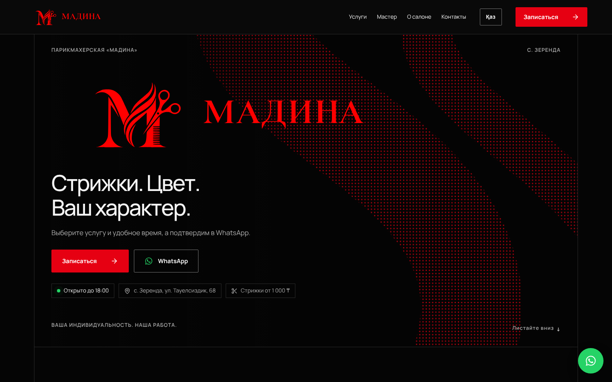
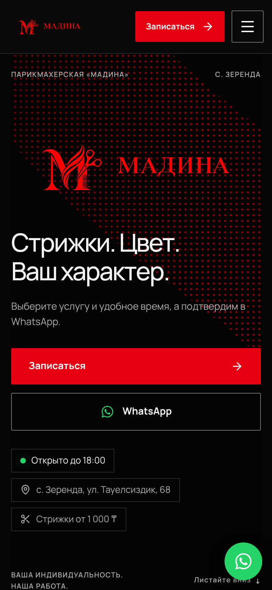
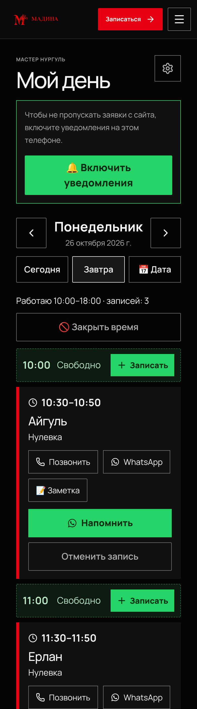
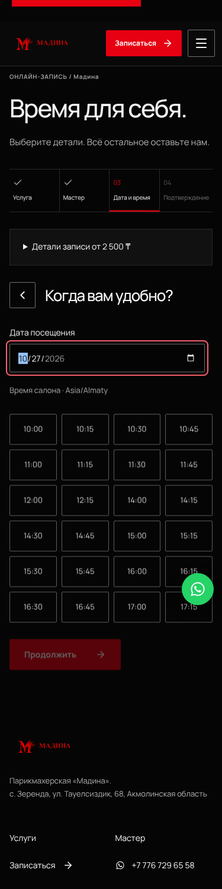

# Мадина — парикмахерская в Зеренде

Сайт с онлайн-записью и рабочий кабинет для небольшой парикмахерской: клиенты записываются сами, мастер ведёт день с телефона, владелец видит выручку и клиентов.

**🌐 [madina-salon.vercel.app](https://madina-salon.vercel.app)** · с. Зеренда, ул. Тауелсиздик, 68 · Пн–Пт 10:00–18:00, Сб 10:00–15:00, Вс — выходной

Автор и сопровождающий: **[Arystan Kabdesh](https://github.com/arystank1511-blip)**.



<table>
  <tr>
    <td width="33%"></td>
    <td width="33%"></td>
    <td width="33%"></td>
  </tr>
  <tr>
    <td align="center">Сайт на телефоне</td>
    <td align="center">«Мой день» — экран мастера</td>
    <td align="center">Онлайн-запись</td>
  </tr>
</table>

## Что умеет

### Для клиентов

- **Запись за минуту без регистрации.** Услуга → дата → свободное время → имя и телефон. После «Записаться» сразу открывается WhatsApp салона с готовым сообщением, время придерживается для клиента на 3 часа.
- **Мужской и женский зал**, 29 услуг с ценами «от», длительностью и описанием.
- **Запись всей семьёй** одной заявкой: «+ Добавить человека», и визиты встают подряд.
- **Статус «Открыто до 18:00» / «Закрыто · откроемся в понедельник в 10:00»** считается по реальному расписанию.
- **Личная ссылка на запись**: посмотреть, перенести или отменить без звонка (не позже чем за 2 часа). Ссылка подписана HMAC, чужую не подобрать.
- **Лист ожидания**: если день занят, клиент оставляет телефон, и мастер узнаёт, когда время освободится.
- **Цена по фото**: кнопка отправляет фото желаемой стрижки в WhatsApp.
- **Подарочные сертификаты** со своей страницей для печати и кодом.
- **Отзывы и рейтинг** мастера; после визита клиент ставит оценку: 4–5 звёзд ведут в 2ГИС, 1–3 приходят только владельцу.
- **Казахская версия** («Қаз / Рус»), разметка schema.org для Google, `sitemap.xml`, превью ссылки для мессенджеров.

### Для мастера — «Мой день» (`/master`)

Экран для телефона, ставится на главный экран как приложение.

- Новые заявки с сайта сверху: **«Подтвердить»** или **«Отказать»**.
- День по порядку: записи, перерыв, свободное время. **«+ Записать»** — для тех, кто записался по телефону или пришёл без записи.
- **«🚫 Закрыть время»** — закрыть любой отрезок дня, чтобы сайт его не предлагал; **«Открыть»** — вернуть.
- У записи: «Позвонить», «WhatsApp», заметка о клиенте, **«Напомнить»** с готовым текстом.
- После визита: **«₸ Оплата»** (наличные или Kaspi QR) и «Не пришёл».
- **Push-уведомления** на телефон (Android и iPhone): новая заявка, клиент через час, утренняя сводка. Кнопка «Проверить» сообщает, дошло ли уведомление именно до этого телефона.
- Отдельный вход для мастера: только «Мой день», без цен и статистики.

Простая инструкция для мастера с картинками — в PDF, её выдаёт владелец.

### Для владельца — админка (`/admin`)

- **Услуги и цены** прямо в таблице, мастера, расписание по дням, перерывы и отсутствия.
- **Статистика**: выручка, средний чек, новые клиенты, неявки, наличные/Kaspi, откуда узнали о салоне, график по дням; **расходы и прибыль**; **склад** материалов с напоминанием «заканчивается»; **выгрузка в Excel**.
- **Клиенты**: карточка по номеру телефона, история визитов, заметки, «только через WhatsApp».
- **Возврат клиентов**: попросить отзыв, «пора подстричься» через N недель, бонусы постоянным и «Приведи подругу» (выключены, пока их не включить).
- **Сайт**: акция-баннер, фото работ (загружаются и с телефона), отзывы, сертификаты, плакат и визитки с QR-кодом, готовые тексты для 2ГИС, Instagram и WhatsApp Business.
- **Уведомления в Telegram** владельцу и мастеру: каждая заявка, отмена и перенос, напоминание за час, утренняя сводка в 09:00, итоги недели по понедельникам.
- По желанию — автоматические сообщения клиентам через **WhatsApp Business API**.

## Как устроено

|            |                                                                                   |
| ---------- | --------------------------------------------------------------------------------- |
| Frontend   | React 19, Vite, TanStack Query, React Router                                      |
| Backend    | NestJS 11, Prisma 6, class-validator, Swagger                                     |
| База       | PostgreSQL (Neon): миграции SQL, `btree_gist`                                     |
| Хостинг    | Vercel: статика + API как serverless-функция, регион `fra1`                       |
| Расписание | GitHub Actions каждые 10 минут вызывает `/api/v1/cron/reminders`                  |
| Тесты      | Vitest, Jest + Testing Library, интеграционные на реальной PostgreSQL, Playwright |

- **Двойная запись невозможна на уровне базы**: блокировки PostgreSQL и ограничение GiST `EXCLUDE` по мастеру и времени. Проверено 10 параллельными запросами через два независимых экземпляра API.
- **Безопасность**: HttpOnly-сессии (в базе хранится SHA-256 токена), пароли scrypt, роли на сервере (администратор, мастер, клиент), CSRF по `Origin` и заголовку, ограничение попыток входа.
- **Секреты не в коде**: логин администратора задаётся переменными Vercel, ключи VAPID, секрет ссылок и токен WhatsApp создаются в базе.
- Монорепозиторий pnpm: `apps/web` (сайт), `apps/api` (API, схема и миграции в `apps/api/prisma`), `e2e` (Playwright), `api/index.js` (точка входа Vercel).

Подробнее: [архитектура и ERD](docs/ARCHITECTURE.md), [развёртывание](docs/DEPLOYMENT.md), [Vercel](docs/VERCEL.md), [отчёт проверок](docs/VERIFICATION.md).

## Запустить у себя

Нужны **Node 24**, **pnpm 10.30.3** и **PostgreSQL 16+** (или Docker).

**Docker** — всё сразу на http://localhost:8080:

```sh
docker compose up --build -d --wait
docker compose exec api pnpm db:seed
```

**Без Docker** — сайт на http://localhost:5173, API на :3000:

```sh
corepack enable && pnpm install --frozen-lockfile
cp .env.example apps/api/.env   # укажите DATABASE_URL своей PostgreSQL
pnpm db:generate && pnpm db:migrate
DEMO_MODE=true pnpm db:seed
pnpm dev
```

Демо-данные создаются только при `DEMO_MODE=true` и не в production. Вход в демо: `admin@forma.example` / `FormaDemo2026!`. На рабочем сайте этого логина нет.

## Проверки

```sh
pnpm build && pnpm typecheck && pnpm lint && pnpm exec prettier --check .
pnpm test                 # unit-тесты API и сайта
pnpm test:integration     # нужна база с именем forma_test (TEST_DATABASE_URL)
pnpm test:e2e             # Playwright на запущенном демо-сайте
```

GitHub Actions прогоняет всё это на каждый pull request. После слияния в `main` Vercel сам публикует сайт и применяет миграции.

## Настройка рабочего сайта

Переменные в Vercel (Settings → Environment Variables, Production):

| Переменная                      | Зачем                                                                    |
| ------------------------------- | ------------------------------------------------------------------------ |
| `DATABASE_URL`                  | PostgreSQL (Neon подключает сам)                                         |
| `ADMIN_EMAIL`, `ADMIN_PASSWORD` | логин владельца; при деплое заменяет демо-логин один раз                 |
| `TELEGRAM_BOT_TOKEN`            | уведомления в Telegram; получатели — `TELEGRAM_CHAT_ID` через запятую    |
| `CRON_SECRET`                   | необязательно: тот же секрет в GitHub Actions защищает вызов напоминаний |
| `SALON_*`, `PUBLIC_HOST`        | название, адрес, часы, WhatsApp, домен — см. `.env.example`              |

Мастеру вход создаётся в админке: «Пароль» → «Вход для мастера». Каждый получатель Telegram должен один раз нажать «Запустить» в боте салона.

## API

Swagger: `/api/docs`, OpenAPI: `/api/openapi.json`, префикс `/api/v1`, проверка: `/api/v1/ready`. Изменяющие запросы требуют `Origin` сайта и заголовок `X-CSRF-Protection: 1`. Занятое время — HTTP 409 `SLOT_UNAVAILABLE`.

---

Сайт сделан для семейной парикмахерской «Мадина». Название FORMA в пакетах и коде — внутреннее имя проекта.
