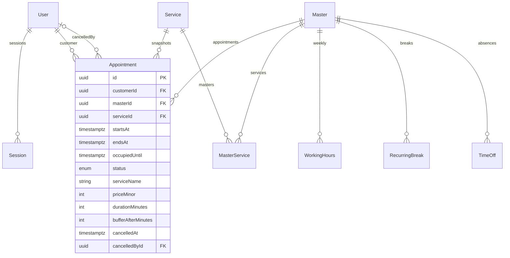

# Архитектура

`apps/web` — React 19, Vite, React Router, TanStack Query, React Hook Form + Zod, Tailwind 4 и общие CSS-токены. `apps/api` — NestJS 11, Prisma 6, PostgreSQL 17. API разделено на авторизацию, бронирование, чистые правила доступности, публичный каталог, административные операции. Микросервисов и внешних платных зависимостей нет.

## Защита от двойной записи

1. Начинается транзакция READ COMMITTED.
2. Строка услуги блокируется FOR SHARE. Редактирование услуги берёт FOR UPDATE, поэтому цена/длительность читаются согласованно.
3. Строка мастера блокируется FOR UPDATE.
4. После ожидания повторно загружаются актуальные услуга, мастер, связи, часы, перерывы, отсутствия и занятые интервалы.
5. Тем же модулем, что обслуживает публичную доступность, вычисляются разрешённые слоты. Точный присланный момент обязан совпасть со слотом, без округления.
6. Сервер сохраняет цену, длительность, буфер и название услуги, границы интервалов и CONFIRMED.
7. Commit освобождает блокировки. Следующий запрос видит предыдущую запись.

Все изменения расписания, перерывов, отсутствий, активности мастера, набора услуг, отмена и завершение также блокируют Master. Порядок: **Service → Master → Appointment**, когда эти строки нужны операции; операция никогда не получает Service после Master. Общая услуга блокируется FOR SHARE, поэтому разные мастера не сериализуются на строке услуги.

Дополнительная SQL-миграция устанавливает `btree_gist` и `EXCLUDE USING gist (masterId WITH =, tstzrange(startsAt, occupiedUntil, '[)') WITH &&) WHERE status <> 'CANCELLED'`. Это защищает БД даже от INSERT в обход приложения. CHECK проверяет положительные интервалы, точную длительность/буфер, цены, состояние отмены, локальные часы. Только ошибка названного EXCLUDE преобразуется в SLOT_UNAVAILABLE; остальные ошибки обрабатываются отдельно.

## Время

- PostgreSQL timestamptz для абсолютных моментов.
- Регулярные окна: ISO weekday 1–7 и локальные HH:mm в часовом поясе салона.
- Интервалы полуоткрытые [start,end), буфер входит в занятость, отмены освобождают время.
- Шаг 15 минут относительно начала рабочего окна, не относительно полуночи.
- Не менее 30 минут до начала; сегодня и следующие 59 календарных дат (60 дат всего).
- Времена без Z или явного offset отклоняются DTO.
- Temporal `disambiguation: reject` исключает неоднозначные/несуществующие локальные времена. Если граница окна или перерыва в день перехода DST неоднозначна, день/соответствующие слоты консервативно закрываются. Тихого сдвига времени нет.
- Frontend форматирует время явно через Intl с настройкой салона; браузерный часовой пояс не влияет на запись.

## Сессии и CSRF

256-битный случайный токен передаётся только HttpOnly SameSite=Lax cookie, в БД — SHA-256 и expiry. Production добавляет Secure. Пароли: scrypt с индивидуальной 128-битной солью и сравнением timingSafeEqual. Публичная регистрация не принимает role. Доступ к каждой записи проверяется на сервере.

Изменяющие HTTP-запросы требуют точного Origin и нестандартного заголовка `X-CSRF-Protection: 1`. Другой origin не может поставить этот заголовок без CORS preflight, который здесь не разрешён. Это защита на уровне браузерной модели origin, а не секретный CSRF-токен. Параметры цены, customerId и статуса от клиента запрещены whitelist DTO.

## ERD

